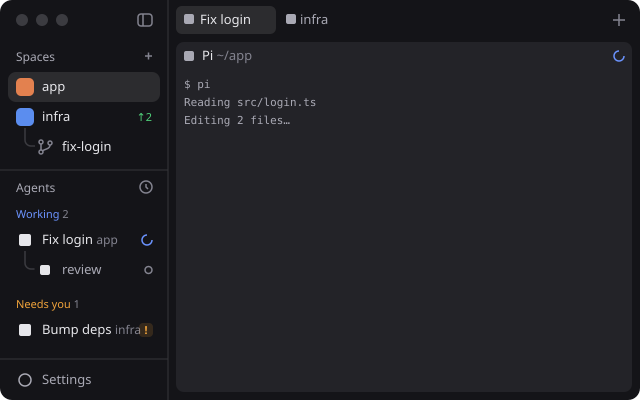

# herdr-settings

我当前在用的 [Herdr](https://herdr.dev) 布局 `herdr-t3`，以及它用到的 mod 和快捷键。



## 内容

| 路径 | 说明 |
| --- | --- |
| `layouts/herdr-t3.json` | 布局（从 Herdr 自带的 `main` 克隆后改的），`herdr-t3.svg` 是预览图 |
| `mods/t3-spaces` | 左侧空间列表：固定颜色头像、worktree 挂在所属 checkout 下，多台机器时按机器分组 |
| `mods/t3-agents` | Agent 列表，分组或按优先级显示；父 agent 取其最紧急子 agent 的位置 |
| `mods/t3-focus` | 专注侧栏：只显示还在等你处理的 agent 卡片，下面是 Working |
| `mods/t3-tabs` | 顶栏标签和窗口按钮；`t3-tabs.view` 在标签视图和单 agent 视图间切换 |
| `mods/t3-chrome` | 侧栏顶部品牌栏（留出红绿灯、可拖动窗口）和底部 Settings；`t3-chrome.sidebar` 在空间/Agent 列表和专注侧栏间切换 |
| `mods/t3-tools-nav` | 右侧工具面板顶部的分段切换：Files / Changes / Sessions / Favorites；面板窄于 340px 时只显示图标（悬停有提示） |
| `mods/t3-files` | 克隆自内置 `files`：鼠标移到行上出现收藏（文件夹）、`cd` 进当前终端（文件夹）、复制路径 |
| `mods/t3-changes` | 克隆自内置 `changes`，提交区参考 [Orca](https://github.com/stablyai/orca) 重写：多行提交信息（⌘↵ 提交）；输入框角上的 ✨ 让 agent 按最近提交的语言和风格写提交信息，生成中可点停止；左下角选用哪个 agent（Claude Haiku / Claude Sonnet / Codex / pi / opencode，没装的会标出来，选择存在 `t3.commit.agent`）。agent 以一次性、只读、无会话记录的方式运行，prompt 走 stdin；diff 最多 60000 字符，按文件均分，会发给所选 agent 背后的模型 |
| `mods/t3-sessions` | 当前 space 项目里的 pi / Claude Code / opencode 会话，点一条在原目录恢复；`+` 加标签，搜索框里 `#标签` 按标签过滤 |
| `mods/t3-favorites` | 收藏的目录，点一下切到那个 space（没开就新建）；**Add current** 收藏当前 space 的目录 |
| `mods/t3-pane` | 终端窗格的标题栏（分屏、缩放、关闭） |
| `mods/t3-new-menu` | 新建菜单：先选空间（或新建），再选要运行的程序；由 `t3-tabs` 打开 |
| `keys.json` | 只含 `layout:herdr-t3` 这一段快捷键（`cmd-shift-b` 切换侧栏、`cmd-shift-a` 切换 agent 视图） |

布局还用到 Herdr 自带的 `workspace-status`、`workspace-chrome`（图标），这些随 Herdr 安装，不在本仓库里。

`t3-files`、`t3-changes`、`t3-sessions`、`t3-favorites` 移植自 [Lamb-Yang/herdr-sessions](https://github.com/Lamb-Yang/herdr-sessions)，界面改成英文；收藏和标签存在 Herdr 的 `shared.json`，键是 `t3.favorites` 和 `t3.sessions.tags`。Sessions 需要 `python3`（读会话文件）和 `sqlite3`（读 opencode），恢复会话要用到对应的 `pi` / `claude` / `opencode`。

## 安装

```bash
git clone <this repo> ~/Developer/github/herdr-settings
~/Developer/github/herdr-settings/install.sh
```

把布局和 mod 拷进 `~/.config/herdr-app`（`HERDR_APP_HOME` 可改），同名的先备份成
`<name>.backup-<时间>`；把快捷键段合并进 `keys.json`；逐个 `herdr-app check`，通过后切到 `herdr-t3`。

卸载：`./uninstall.sh`，删掉这些文件并还原安装时的备份，再从 `keys.json` 里去掉这一段。

## 同步

改完布局或 mod 后，把 Herdr 里的最新版本拉回仓库：

```bash
./sync.sh            # 当前窗口在用的布局
./sync.sh bercail    # 或指定布局
```

它会重新生成 `layouts/`、`mods/` 和 `keys.json`：只取这个布局，以及它用到的、不是 Herdr 自带的 mod
（包括 mod 代码里引用到的其他 mod）。`gpui-kit.d.ts`、`jsconfig.json` 是 Herdr 生成的编辑器文件，不入库。
