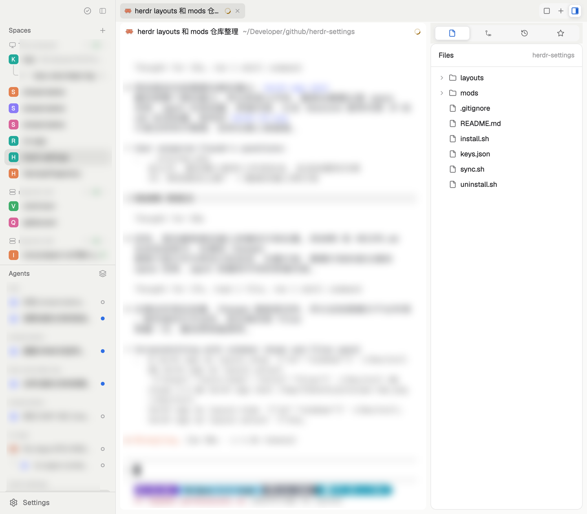

# herdr-t3

A working layout for running coding agents: a 268px sidebar with spaces and agents (or a focus
list of the agents waiting on you), a 40px tab bar, the terminal, and a 368px tools panel on the
right with Files, Changes, Sessions and Favorites. Everything follows the theme's tokens, so it
looks native in light and dark.



**What you see:** left to right. The sidebar (`background: chrome`, 268px, `min 180`, `max 480`)
holds a 40px brand bar with the traffic lights at `[16, 13]`, then either Spaces over Agents
(`weight 1` each, `min 90`) or the Focus list, then a 41px footer with Settings. The work column
has a 40px tab bar, then a row (padding `[2, 8]`, gap 8) with the active tab's panes and the tools
panel, then a 6px inset. Panes have a 28px `t3-pane` header on top, radius 8, gap 8, a 2px border in
the background colour and terminal padding `[8, 0]`. The tools panel (368px, `min 280`, `max 900`,
hidden at first) is a 38px segmented switch over a stack of four panels. Root: `background: canvas`,
1px `border` dividers, `titlebar: "none"`, `terminal_opacity: 0`. Type is the theme's own; panel
text 11–13px.

- **Spaces**: a coloured letter avatar per space (one of `ansi1`–`ansi6`, kept in
  `shared("space.colors")`), worktrees indented under their checkout, grouped by machine when more
  than one is known; a branch or ahead/behind only when unusual.
- **Agents**: Priority (blocked, done, working, idle) or Grouped by space; a parent takes its most
  urgent sub-agent's place.
- **Tab bar**: tabs named after their lead agent, then a 28px button group on a `raised` track:
  one-agent view, New…, tools panel. The button whose thing is showing sits raised (`background`
  fill, 1px `border`, small shadow, `accent` icon).
- **Tools switch**: four equal segments (Files, Changes, Sessions, Favorites) on a 30px `raised`
  track; labels show from 326px of track, icons only below.
- **Files**: the focused pane's folder as a lazy tree with git marks (A, M, D, U).
- **Changes**: a header (`N files`, `+a −d`, and a Review all changes icon), a multi-line message
  box (2–8 rows) with ✨ in its corner, an agent chip and a 24px Commit button; then the changed
  files in folding sections as editors draw them: Merge, Staged, Changes, Untracked, each an
  uppercase label with a count pill. A 26px row is a file icon in its status colour (added and
  untracked `ansi2`, deleted and conflicted `ansi1`, modified `ansi3`), the name, its folder
  dimmed, `+a −d` and the status letter. With nothing changed, an icon in a circle over a title
  and a line of detail.
- **Diff window**: GitHub's "Files changed" in a 1040×760 window or a tab, in GitHub's colours
  (`t3-changes/github.js`: Primer's light or dark palette by the app background's luminance, over
  the theme's names, so `background` is `#ffffff` / `#0d1117`, `border` `#d1d9e0` / `#3d444d`,
  `accent` `#0969da` / `#4493f8`): a 44px title bar
  (`Changes`, file count, `+a −d`, a Send button once there are comments, `x / N viewed`, Refresh,
  Collapse all, and in the window Open in a tab and ✕), a 260px tree of the files under their
  sections (one-child folders squashed to `src/lib`, a ✓ on viewed files) and the diffs stacked as
  cards: a 34px `raised` header (fold chevron, status, folder dimmed and name bold, a section
  badge, `+a −d`, a 40px comment button with the file's count, an 82px Viewed checkbox), then 20px rows with old and new line numbers in two
  46px gutters, in the terminal font. Lines and their numbers take GitHub's diff colours, the
  numbers a shade deeper: added `#dafbe1` / `#aceebb`, removed `#ffebe9` / `#ffcecb`, the hunk
  line `#ddf4ff` with a `#b6e3ff` cell over both gutters, picked lines `#fff8c5` / `#fae17d` (dark:
  `#2ea04326` / `#3fb9504d`, `#f851491a` / `#f851494d`, `#388bfd1a` / `#388bfd66`, `#bb800926` /
  `#bb800966`). A comment is a card under its line inside the file's card
  (`background`, 1px `border`, radius 8: `Lines 3–5 · 2m ago`, then the text wrapped to fit);
  A commentable line under the pointer shows a 17px `accent`
  square (radius 4) with a 13px `accent_foreground` + over the sign column, 87px in, on a layer over
  the whole row at opacity 0, 1 while hovered (a row takes no handlers, and a hover colour reaches
  no child). The comment form is
  GitHub's, under the last picked line (or at the top of the file, or in place of the comment it
  edits): a box (`background`, 1px `border`, radius 8, 12px in from the card, 10px padding) with
  the title (`Add a comment on lines R3 to R5`, `L` for removed lines, bold 13px, then the path
  dimmed), an editor box (radius 6) of a `raised` tab bar (76px `Write` and `Preview`, the selected
  one on `background` with no bottom border; at the right a 28px `file-diff.svg` button for line
  comments), the text (a textarea in a radius-6 box, `accent` border while typing, 96–260px tall
  as the text needs; Preview renders it as Markdown) and a dim hint line, then Delete (editing) at
  the left and Cancel (`#f6f8fa`) / Add comment (green `#1f883d`, `#94d3a2` while empty;
  Send is the same green) at the right, 32px tall.
- **Sessions**: rows of title, `time · folder` and tags, led by the agent's mark on a 22×20
  `raised` tile: Claude `#D97757`, Codex `#5B7CFF`, pi `#1F9D8A`, OpenCode in the text colour. The
  header counts sessions per agent as mark + number, only for agents present.
- **Favorites**: two-line rows (name; machine · folder) with an `Open` badge when a space is there.

**How it behaves:** agent statuses read the same everywhere: working is a spinning
`mods/workspace-chrome/spinner.svg` in `working`, blocked a `!` on a `blocked` tint, done a 7px
`done` dot; a viewed done agent turns idle. Clicking a space or tab selects it; right-click opens
its menu; tabs drag to reorder and double-click renames. `cmd-shift-b` switches the sidebar between
lists and Focus, `cmd-shift-a` between tabs and the one-agent view.

Motion is native and small: hover actions fade (140ms ease-out), menus and banners fold (180ms
ease-out), the tools pill springs between segments (response 260, damping 0.86) and follows the
panel's width. Every button has a hover fill and a darker pressed state.

- **Files**: hovering a row fades in Favorite (folders), `cd` here (folders) and Copy path; a done
  action shows a green check for 1.2s instead of a toast.
- **Changes**: ✨ runs the agent from the chip (Claude Haiku and Codex GPT-6-Luna at low effort,
  pi at low thinking on its own model, OpenCode on its own, or yours; the chip, at most 240px, and
  the menu name each one's model and effort, a config default by what it resolves to, and mark
  missing ones `not installed`) and fills the box; while it runs the ✨ spins and turns
  into a red stop square under the pointer. Disabled states explain themselves in the tooltip
  (loading, committing, no changes, message not empty, remote repo, no agent on, agent not
  installed). The chip drops its menu over the file list; its last row, Settings…, opens a 560×640
  dialog after Orca's: a card per agent (a logo tile that drops a 6×2 grid of marks, Name, an
  on/off switch whose knob springs across, ✕; then a Model dropdown, 340px, with a search field
  that also takes a typed name, Default first as `Default · <what the config runs>`, the listed
  models with their descriptions, and a footer `N models · listed 5m ago` with Refresh; an Effort
  dropdown, 118px, hanging from its right edge, with Default and the levels that model takes;
  then its command in a mono input, and a note when its program is missing or a choice has no
  placeholder to go to), then a full-width 36px dashed Add agent slot (accent border and text on
  hover); the prompt's instructions in a mono textarea. Restore defaults and Reset to default sit
  at the right of their section titles, fading in once something differs. Cancel or Esc drops the
  edits; Save or ⌘↵ stores them. ⌘↵ or Commit commits what is staged, or stages everything first
  when nothing is; ✨ writes about the same (the staged diff, else everything). A green
  `✓ Committed <hash>` banner folds open under the button for 2.2s.
- **Changed files**: a section header folds its section (height, 180ms) and fades in Stage all or
  Unstage all on hover. Hovering a row swaps its counts for Discard (the first click turns it red,
  a second within 3s discards), Stage or Unstage. Clicking a row, or Review all changes, opens the diff window
  on that file; opening it again replaces it.
- **Diff window**: a tree row scrolls its card to the top and `j` / `k` step through the files;
  a click on a card header folds it, on Viewed marks it viewed and folds it (unmarking unfolds);
  diffs over 800 lines start folded, saying `Large diff · N lines`; Collapse all folds every card.
  Long lines wrap at what fits, as GitHub's do (at spaces, else mid-word), each wrapped row 20px
  with the number and sign on the first; nothing scrolls sideways. Esc closes the window.
  It reads the changes again when the folder changes and on Refresh, keeping viewed and folded
  files by `area:path` (a viewed file whose diff changed is unviewed, as on GitHub). Open in a tab
  closes the window and opens `tab.new { name: "Review · <repo>", mod: "t3-changes", props }` with
  the same files, viewed and folded.
- **Comments**: click a line (or its +) to start one there; shift-click another line of the file for the
  lines between; the header's comment button comments on the whole file; ⌘↵ adds, Esc cancels,
  typed text stays when another line is picked; ± adds a ```suggestion block of the picked lines'
  new text. A click on a comment edits it. A list row takes no handlers, so the form is five list
  rows and a click on its tabs or buttons is told apart by where the press landed. Comments and the
  draft follow their lines when the diff is read again: the row on their side whose text is the
  quote's last line, the more lines above matching the better, then the nearest; moved comments
  get their new line numbers saved. Send drops a 300px
  menu: `Paste into the prompt of`, the agents of the shown space (all when it has none; focused
  first, then the most recent) with tab and status, a `Clear after sending` checkbox (off: `kept,
  marked sent`), Copy as text, Delete sent comments (when some are), Delete all comments. The
  button reads `Send N comments` for the unsent ones, or `Send N again` when every one was sent.
  Sending writes one prompt to the clipboard, closes the window (a tab stays), runs `agent.focus`
  then `terminal.paste`: it lands in the agent's prompt unsubmitted. What went is marked `sent: {
  to, at }` (a green `✓ sent to <agent>` on its card), or removed when the checkbox is on; an edit
  clears the mark.
- **Sessions**: rescans every 30s and whenever the space or focused terminal changes. A click
  resumes the session in a new tab in its recorded folder; `+` (fades in on hover) adds
  comma-separated tags; clicking a tag filters by it; search takes words and `#tag`s.
- **Favorites**: a click selects the space on that folder or makes one; Add current saves the
  space's own folder; Add a folder… picks any; ✕ (fades in on hover) removes.

**Built from:** `layouts/herdr-t3.json`, a `row`:

- `sidebar` (column): `brand` → `t3-chrome` (40px, `window_drag`); stack `sidebar-lists`
  (`active: lists`) of column `lists` [`spaces` → `t3-spaces`, `agents` → `t3-agents`] and `focus` →
  `t3-focus` (`props.newMenu: "t3-new-menu"`); `sidebar-footer` → `t3-chrome` (`props.footer: true`,
  41px).
- `work` (column): `tabs` → `t3-tabs` (40px, `window_drag`); row `work-body` of stack `view`
  (`main` = `{ tab: "active", pane: { header: { content: { mod: "t3-pane" }, height: 28 } } }`,
  `agent` = `{ agent: "focused" }`) and column `panel` [`tools-nav` → `t3-tools-nav` (38px), stack
  `tools-body` of `files` → `t3-files`, `changes` → `t3-changes`, `sessions` → `t3-sessions`,
  `favorites` → `t3-favorites`]; `work-bottom-inset` (6px); `status` → `workspace-status` (hidden).

Mods: `t3-files` and `t3-changes` are clones of the shipped `files` and `changes`
(`mod.clone`); `t3-changes/ai.js` holds the logos, the default agents (each a shell command with
`{model}` and `{effort}`), their substitution,
prompt, diff budget and output cleanup; `t3-changes/models.js` lists each CLI's models (Claude
`-p --input-format stream-json` with a `list_models` control request; Codex `app-server`
`model/list` paged by a `python3 -c` client; pi `--list-models` plus `~/.pi/agent/settings.json`
for its default; `opencode models`); `t3-changes/settings.js` draws the dialog, which is
`t3-changes` itself opened with `openOverlay({ kind: "dialog", props: { settings: true } })`;
`t3-changes/comments.js` keeps, places, wraps and formats the comments; `t3-changes/diff.js`
draws the diff window the same way (`kind: "window"`, `key: "t3-diff"`,
`props: { diff: { root, on, files, focus } }`), reading `git diff --cached` for staged files, `git
diff` for the rest and untracked files whole. Git actions: stage `add --`, unstage `restore
--staged --` (`rm --cached` before the first commit), discard `restore --worktree --` or `clean
-f` for an untracked file.
`t3-sessions` scans with one `python3 -c` pass (pi `~/.pi/agent/sessions/*/*.jsonl`, Claude
`~/.claude/projects/*/*.jsonl`, Codex `~/.codex/sessions/*/*/*/rollout-*.jsonl` titled from
`~/.codex/session_index.jsonl`) plus `sqlite3` on `~/.local/share/opencode/opencode.db`. Agent
marks are `mods/t3-sessions/agents/*.svg` (claude, codex, pi, opencode, cursor, kimi, grok, devin,
deepseek, generic), used by both mods. Shared state:
`t3.favorites`, `t3.sessions.tags`, `t3.commit.agent`, `t3.commit.settings` (`{ agents: [{ id,
name, logo, model, effort, command, off? }], prompt }`, each left out while it matches the
default), `t3.review.comments` (by repository root: `[{ id, path, side: "new" | "old", line, from, code,
body, at, sent, area }]`, `line` null for the whole file, `area` the section it was left in, `sent` `{ to, at }` or null), `t3.review.clearSent` (true: clear comments once sent), `t3.commit.models` (listings by program: `{ at, models: [{ id, label, detail, efforts }],
default: { label, efforts }, error? }`). Calls: `exec`, `hc send` (cd),
`run("terminal.open" | "layout.select" | "layout.toggle" | "space.select" | "space.new" | "mod.open" | "agent.focus" | "terminal.paste")`,
`setShared`, `pickFolder`, `notify`. Shipped mods relied on: `workspace-status`, and art from
`workspace-chrome` (spinner, check, square, chevron-down, plus, panel-right, x, git-compare) and `t3-files`
(file, folder, chevrons); `t3-changes` adds `undo`, `chevron-up`, `chevron-down`, `rotate-cw`, `app-window`, `message-square`,
`send`, `file-diff`, `chevrons-down-up` and `chevrons-up-down` (Collapse all / Expand all).

## Watch out

- Measure, don't trust the layout: the tools pill takes the track's drawn width from
  `on_size_change`; a node's `size.px` can differ from what it got (min/max, unsaved resizes).
- `transition` only animates later changes: anything that fades in on hover or folds open is drawn
  all the time at opacity 0 or height 0. A folded element still counts in its parent's `gap`; wrap
  it with its neighbour instead.
- A dropdown below other content must go in a `Popup`, or later siblings paint over it.
  Its `on_mouse_down_out` closes it on the press, before the trigger's click lands: a trigger that
  toggles would open it again, so a click within 400ms of that close leaves it closed.
- `exec` has no stdin and no cancel: commit messages run through
  `sh -c 'f=$1; p=$2; c=$3; echo $$ > "$f"; printf "%s" "$p" | eval "$c"; …'` and Stop kills the
  whole process tree under the pid in that file (a command can be a pipeline or a wrapper).
- A mod can't import another mod's files (`resolves outside the application directory`): a
  dialog that shares code opens the same mod with props. Read them with `props()`; `init`'s first
  argument is not the overlay's props.
- Agents run one-shot and isolated: Claude `-p --tools "" --strict-mcp-config --settings
  {"disableAllHooks":true}`; Codex `exec --ephemeral -s read-only`; pi `--print --no-session
  --no-tools --no-skills --no-extensions --no-context-files`. Codex and OpenCode take 14–17s, Claude
  Haiku and pi 2–4s. Model flags: Claude and pi `--model`, Codex and OpenCode `-m` (OpenCode wants
  `provider/model`); effort: Claude `--effort`, Codex `-c model_reasoning_effort=`, pi
  `--thinking`, OpenCode `--variant`. A smaller model barely shortens Codex: `codex exec` itself
  takes most of its 15s.
- `codex app-server` doesn't exit after answering: a listing client reads until the last page,
  then kills it. Its listing can take 5–10s (it refreshes models online first), so listings are
  kept for a day and only made when the menu or dialog opens.
- A virtual list's renderer can't register handlers (`on_click`, `tooltip` throw there, and the
  list draws nothing): the diff cards take one `on_item_click` on the list, and the pane's
  `on_mouse_down` notes where the press landed so Viewed and fold tell apart.
- A sent prompt is one paste: each comment as `File:`, `Line N` / `Lines a–b` (removed lines by the
  old file's numbers), the quoted lines in a ```diff block (at most 12), then `Comment:`.
- A mod tab gets its props from `tab.new`, and nothing can change them later: a tab can't be
  re-pointed, so opening the review again from the panel makes a window, not a second tab.
- `scroll_to_item(i, "top")` only reveals, at the nearer edge: to put a header at the top, reveal
  the item a pane-height below it first, then the header on the next frame.
- Open in a tab builds the tab's view inside the window's click: what that view asks of the host
  then (git, the folder watch) belongs to the window and never answers once the window closes,
  leaving the tab on `Loading changes…`. The review starts its first read and its watch with
  `cx.timer.after(0, …, { owner: view })`, in a call of its own.
- The list needs every row's height before it draws, so wrapping is counted, not measured: the
  code's width over 7.3px a character (a monospace font's 0.6em at 12px, with room to spare), and
  laid out again when the pane's width changes.
- Codex user prompts start with injected context (AGENTS.md, `<environment_context>`…): skip it for
  titles; leave out delegated sub-agent rollouts; collapse a thread's rollouts to the newest.
- A panel is not re-rendered when the space or focus changes: Sessions watches `where()` on a 500ms
  timer.
- Editing a mod doesn't reload the copy on screen: switch layouts and back.
- Sessions filters by the space's own folder, not the terminal's; a space made elsewhere shows that
  folder's sessions.

## Done when

- `herdr-app check` passes for all twelve `t3-*` mods and `layout.switch --name herdr-t3` leaves no
  entry in `herdr-app status`'s `errors`.
- The tools button opens the panel; each segment shows its panel and the pill slides under it.
- In Files, hovering a folder fades in three actions; Copy path leaves the absolute path on the
  clipboard and shows a check.
- In Changes, ✨ fills the box with a message from the chosen agent, Stop ends it, and
  Commit commits and shows the banner.
- In Settings…, Claude's Model lists Opus, Fable, Sonnet and Haiku after `Default · Opus 5.5`,
  Codex's Effort for GPT-6-Luna offers Low to Max, switching an agent off drops it from the menu, a
  picked logo and model show on the chip (`Claude · Haiku`), pi's chip names its configured model, an added `cat` agent fills the box with the prompt itself (your
  instructions first), and Cancel leaves `t3.commit.settings` as it was.
- With staged, unstaged and untracked files, Changes shows three sections; Stage on a row moves it
  to Staged, and Commit then commits only that.
- In the review, clicking line 3 then shift-clicking line 5 and typing ⌘↵ leaves a `Lines 3–5`
  card under line 5 and `1` on the file's comment button; Send lists the space's agents, and
  sending to one leaves the prompt in its input, unsubmitted, and the card tagged `sent to
  <agent>`; with Clear after sending ticked, `t3.review.comments` for that repository empties.
- Open in a tab turns the window into a `Review · <repo>` tab with the same viewed files.
- Review all changes opens the window with every file as a card; clicking a file in the tree
  brings its card to the top, Viewed folds it and ticks it in the tree, and Esc closes it.
- Sessions lists Codex rows with the Codex mark and resumes one with `codex resume <id>` in its
  folder; `#tag` narrows the list.
- Favorites' Add current saves the space's folder and a click switches to that space.
